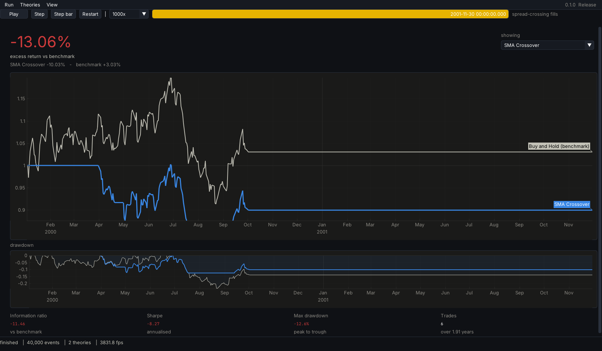
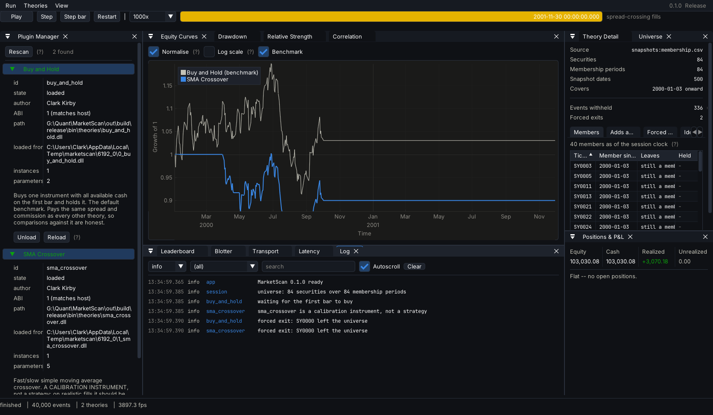
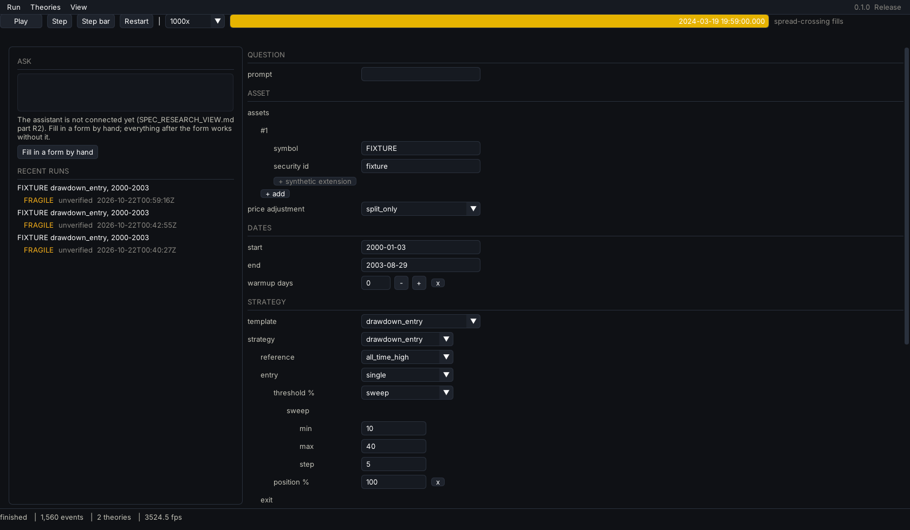
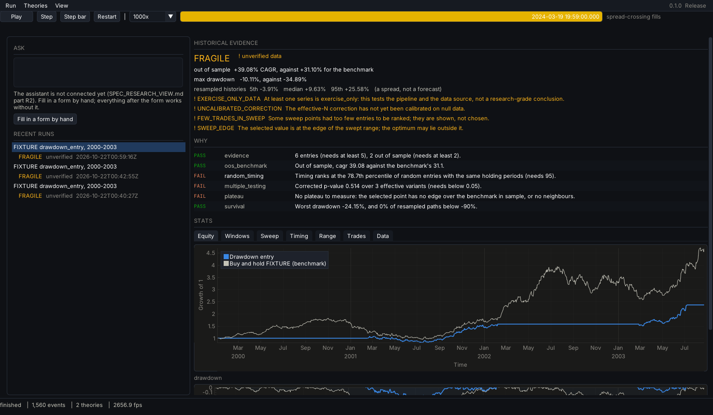
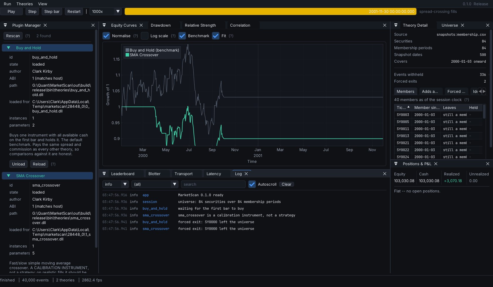

# MarketScan

A quantitative trading research platform in C++20, built around one idea:

> **A strategy cannot tell whether it is being backtested, paper traded, or trading live.**

Same strategy binary, same engine, same ledger, same fill simulator. Only the *clock* and the
*transport* swap out. There is no "backtest mode" code path to diverge from production.

The second idea is the `theories/` folder as a **USB port**: a compiled strategy plugin dropped
into it is discovered at runtime, loaded, given its own virtual account, and shown in the GUI —
with no recompile of the host and no changes to host code.

> **New here?** [**`docs/WRITEUP.md`**](docs/WRITEUP.md) is the short account of what
> this produced and why the interesting part is that the headline result was
> retracted. Everything below is the reference material behind it.

---

## What this project actually produced

A strategy in this repository measured a **Sharpe of 2.414**, against a **1.927** bar that a
1,512-run null sweep had established as the threshold a result must clear before it can be
called distinguishable from noise.

It was an artefact. Every one of its fills — 56 of 56 on one fixture, 55 of 55 on another — had
taken its price from the very bar its own decision was made on. Corrected, the same strategy
measures **1.810**. Below the bar.

**The apparent result was the lookahead**, and three instruments caught it: a bit-exact parity
assertion between two independent implementations, a per-fill timestamp triple, and an
empirically measured null threshold. None of them was built to look for it.

Those two implementations are duplicated deliberately, and collapsing them would leave the
assertion passing while measuring nothing — see [`docs/AUDIT.md`](docs/AUDIT.md) under
"Deliberate duplication".

That is the thing worth handing over. Not a result — a set of instruments that can tell you when
you do not have one. The full account is in [`docs/STATUS.md`](docs/STATUS.md).

> **No real market data has ever entered this pipeline.** Every fixture is synthetic, every
> factor is planted, and not one number in this repository is a statement about markets. That is
> a design constraint, not a gap — see [what is missing](#what-this-is-not), below.

---

## The views

One running engine, two presentations, one keystroke apart (<kbd>F2</kbd>) — and a third view for
research, on <kbd>F3</kbd>.

**Overview** — *is this working, and is it beating the market?* One number, one chart, one
drawdown strip, four figures. Legible from across a room, and deliberately missing everything
that does not answer that question.



**Operator** — the working view. Every theory in its own colour, the blotter, positions, the
universe, the log, latency, and the plugin manager.



Both read the same published snapshot, and **no view computes a metric of its own**: a number a
view needs goes into the snapshot, where both modes read the same object. There is exactly one
equity chart implementation in the codebase, instantiated twice at different densities, and a
test asserts the two produce identical curve geometry and identical entity-to-colour assignment.

Colour follows the entity, assigned from its stable plugin id — never from draw order — so hiding
a series repaints nothing and the leaderboard never stops matching the chart.

### Research (<kbd>F3</kbd>)

A third view asks a different question: *is this idea any good, according to history?* A trading
rule is written as a Strategy Form — by hand for now; the assistant that will fill it from plain
English is not connected yet — and the research job runs it as a sweep, grades it against fixed
gates, and returns a Results document. The screen reads in a fixed order: the verdict, the gates
behind it, the stats, and only then any analysis, because analysis, however careful, can mislead.





The verdict is a grade — supported, fragile, not supported, insufficient evidence — computed by
published rules, never written by a language model, and never phrased as advice. The job's
specification is [`contracts/research/JOB.md`](contracts/research/JOB.md); the research layer
regrades every committed run from the engine's trace and must agree. Headless, the same job is
`ms_research --form form.json --daily <dir> --out <dir>`. See
[`SPEC_RESEARCH_VIEW.md`](docs/specs/SPEC_RESEARCH_VIEW.md) and
[`contracts/`](contracts/README.md).

---

## The survivorship guard, made visible

A backtest over today's index members, applied to history, reports a premium nobody could have
earned. The defence here is structural rather than a rule to remember: when a universe is
installed, a strategy is never shown a bar for a security that was not a member that day, and the
host context gives it no API by which to ask about one.

The Universe Inspector is where that becomes something a person can look at — membership over
time, every add and drop, the forced exits that actually happened, and each identity decision with
the rule that made it.



> The **Identity** tab reads `not measured` for all 53 gaps, and that is a true statement about
> the world rather than an unfinished panel. See [what this is not](#what-this-is-not).

---

## Quickstart

```powershell
git clone https://github.com/ckirby04/MarketScan.git
cd MarketScan

./scripts/dev-env.ps1 cmake --preset release
./scripts/dev-env.ps1 cmake --build --preset release

# Through check_skips.py rather than ctest directly: a skipped test is not a
# pass, and this project has the scar to prove it.
./scripts/dev-env.ps1 python scripts/check_skips.py --preset release

./out/build/release/bin/marketscan.exe --data data/samples/synthetic_spy_1min.csv
```

That opens Overview: it discovers both theories in `bin/theories/`, gives each its own virtual
account, replays the committed sample day through them, and shows the result. <kbd>F2</kbd>
switches to Operator. <kbd>Space</kbd> plays or pauses, <kbd>→</kbd> steps one event,
<kbd>Shift</kbd>+<kbd>→</kbd> steps one bar, <kbd>Ctrl</kbd>+<kbd>R</kbd> restarts.

Add `--headless` for the same run as a table, and `--compare-fills` to see what a naive fill model
would have awarded itself:

```
Results (spread-crossing fills)
  theory                     equity   return   sharpe  sortino   max dd      IR  trades   slippage
  Buy and Hold             97936.38   -2.06%   -17.15   -23.00     3.29      --       1      56.34
  SMA Crossover            98647.11   -1.35%   -17.13   -22.25     2.25    7.40      20    1084.26

Results (OPTIMISTIC fills -- not realistic)
  Buy and Hold             97992.72   -2.01%   -16.68   -22.38     3.29      --       1       0.00
  SMA Crossover            99729.37   -0.27%    -3.51    -4.75     1.38   18.75      20       0.00

Cost of assuming optimistic fills
  Buy and Hold                   56.34  of imaginary profit
  SMA Crossover                1082.26  of imaginary profit
```

Twenty round trips, and assuming every one of them filled at the mid price manufactures **$1,082**
out of nothing — enough to turn a losing strategy into one that looks almost flat. That number is
the whole argument for the default fill model, and it is why the optimistic one is available only
as a labelled comparison.

---

## Why the design looks like this

| Decision | Reason |
|---|---|
| Pure **C** plugin ABI | MSVC debug and release CRTs have incompatible STL layouts. Passing `std::string` across a DLL boundary corrupts memory in ways that take days to find. |
| `int64` micro-dollars for cash | Binary floating point cannot represent `0.01`. Cash accounting must be exact; prices may be `double`. |
| Time only via `host->now()` | A strategy that reads the wall clock is not replayable, and a backtest you cannot reproduce is not evidence. |
| Seeded RNG from the host | Same reason. Each theory gets its own stream derived from the run seed, so adding a second theory cannot change the first one's results. |
| Fills cross the spread **by default** | An optimistic fill model turns noise into alpha — see the $1,082 above. |
| Orders can take time to arrive | Optional, off by default. A strategy that has never experienced a pending order is one trained on an assumption that breaks live — see [`docs/EXECUTION.md`](docs/EXECUTION.md). |
| A ticker is an attribute, not an identity | A ticker reused by a different company is two securities. Resolution takes a date, and the dateless overload is a compile error — see [`docs/IDENTITY.md`](docs/IDENTITY.md). |
| Survivorship is prevented structurally | A strategy is never shown a company that was not in the index that day, because the host context gives it no way to ask. Not a rule an author has to remember. |
| Benchmark is a plugin, not a special case | Buy-and-hold pays the same spread and runs through the same ledger, so the comparison is apples-to-apples by construction. |
| Metrics return **NaN**, never zero | A Sharpe ratio that is undefined and a Sharpe ratio of zero are different claims. The interface prints `--` for the first. |
| No iteration over hash containers on a decision path | Iteration order is unspecified, and an order book that depends on it is a backtest that cannot be reproduced. |

The ledger's accounting identity is asserted after every fill, in every test, and reported per
theory in the dashboard:

```
equity == starting_cash + realized − commission + unrealized
```

Exactly — not to within a rounding tolerance. That is what the micro-dollar integers buy.

---

## The data layer

```powershell
python scripts/fetch_stooq.py --symbols-file universe.txt   # EXCLUDED -- see below
python scripts/fetch_sp500.py                               # index membership, 1996-
marketscan.exe --headless --build-universe data/cache/universe/sp500_history.csv
marketscan.exe --headless --daily data/cache/stooq --universe data/cache/universe/sp500_history.csv
```

| | |
|---|---|
| [`docs/DATA_POLICY.md`](docs/DATA_POLICY.md) | **How this project acquires data, and what it will not do to get it.** No circumvention, licensed data never committed, approved sources and why Stooq is excluded |
| [`docs/DATA.md`](docs/DATA.md) | Where the bars come from, the binary cache format, and a list of what this data is missing |
| [`docs/IDENTITY.md`](docs/IDENTITY.md) | Why a ticker is not an identity, and how the survivorship guard is enforced |
| [`docs/IDENTITY_DECISIONS.md`](docs/IDENTITY_DECISIONS.md) | Every identity call the engine made on the real index, including the ones that went the other way |

> **The free data stack exists to exercise machinery, not to produce
> conclusions.** No delisting returns, no point-in-time restatements, no
> corporate actions. Every number derived from it is a statement about this
> pipeline. Nothing here is committed: `data/cache/` is gitignored.

> **The price source is currently excluded, not broken.** Stooq put a
> proof-of-work challenge in front of its free endpoint; this project does not
> solve it, and the triviality of the challenge made no difference to that
> decision. See [`docs/DATA_POLICY.md`](docs/DATA_POLICY.md) — rule one, with the
> Stooq case as its worked example. The `fetch_stooq.py` script is kept because
> it detects and reports the gate correctly, not because it gets past it.

---

## Building

**Requirements**

- Windows 11, Visual Studio 2022 (MSVC v143, x64 C++ toolset)
- CMake ≥ 3.25 and Ninja — the copies bundled with Visual Studio are used automatically
- [vcpkg](https://github.com/microsoft/vcpkg) — a **full** clone (not `--depth 1`; vcpkg needs
  history to resolve versions)

```powershell
git clone https://github.com/microsoft/vcpkg.git $env:USERPROFILE\vcpkg
& $env:USERPROFILE\vcpkg\bootstrap-vcpkg.bat
```

The build finds vcpkg via `VCPKG_ROOT`, then `%USERPROFILE%\vcpkg`, then a few other conventional
locations, so no environment setup is normally required. The first configure builds the dependency
tree from source and takes a while; later ones are cached.

`scripts/dev-env.ps1` enters an MSVC developer environment before running the command it is given.
Run it once per command, as in the quickstart above.

**Presets**

| Preset | Contents |
|---|---|
| `debug` | Full desktop build, assertions on |
| `release` | Full desktop build, optimised |
| `full` | `release` plus the Python bindings |
| `ci` | Headless engine, theories and tests — no GUI dependency stack |
| `ci-debug` | `ci` with assertions on |

The two `ci` presets compile with warnings as errors (`/W4 /WX`). The desktop presets do not, so a
warning you introduce while working does not stop you building — it stops you merging.

> ⚠️ A theory plugin **must** be built with the same preset as the host that loads it. Mixing
> Debug and Release binaries across the plugin boundary is undefined behaviour on MSVC. The loader
> checks the ABI version and refuses a mismatch, but it cannot detect a CRT mismatch — so the
> presets keep their plugins in separate output trees.

---

## Writing a theory

A theory is a DLL exporting a handful of `extern "C"` functions. The SDK gives you a C++ base class
that hides the boundary:

```cpp
#include "marketscan/strategy/istrategy.hpp"

class MyTheory final : public marketscan::IStrategy {
public:
    void on_bar(const MS_Bar& bar) override {
        if (position(bar.symbol) == 0.0 && bar.close > threshold_) {
            submit_market(bar.symbol, MS_SIDE_BUY, 100.0);
        }
    }

private:
    double threshold_ = 500.0;
};

MARKETSCAN_EXPORT_STRATEGY(MyTheory, "my_theory", "My Theory", "Your Name")
```

Copy `theories/_template/`, build it, and it appears in the dashboard's Plugin Manager the next
time you press **Rescan** — no host rebuild, and no host code that knows it exists. The host
shadow-copies each DLL out of the way before loading it, so you can rebuild a theory while the
application is running and hot-reload it.

Full walkthrough, including the rules a theory has to follow (no wall clock, no `rand()`, no file
or network I/O, no allocation on the event path) and why each exists:
**[`theories/README.md`](theories/README.md)**.

---

## Live execution, paper only

`ms_live` is the command line to the live seam. It is a separate binary from the
dashboard on purpose: the dashboard reads files, this one opens sockets and sends
orders, so "can this binary reach a broker" has a one-word answer for each.

```powershell
$env:APCA_API_KEY_ID     = '...'   # paper keys, from the environment only
$env:APCA_API_SECRET_KEY = '...'

ms_live guard        # prove the paper-only guard refuses a live host
ms_live account      # what the paper account says about itself
ms_live clock        # the exchange clock, and this machine's skew from it
ms_live calendar     # trading sessions, from the broker rather than hard-coded
ms_live probe        # how this machine behaves with several TLS connections open

# Stream real market data, record it, and force one reconnect:
ms_live record --out session.ndjson --symbols AAPL,SPY --seconds 60 --drop-after 30
ms_live replay session.ndjson

# The equivalence test: run a plugin live, replay the recording with the same
# binary, and compare the decisions.
ms_live equivalence --plugin lifecycle_exercise.dll --out run.ndjson --symbols QQQ

ms_live orders                              # what the venue thinks happened
ms_live positions [--flatten --yes --limit]  # and how to put the account back to flat
```

**Paper only, and structurally rather than by configuration.** The live-money
trading hostname is not in this repository — not in a constant, a comment, a
config example, or behind a flag. Three guards enforce it: a source scan, a scan
of the built binaries, and a constructor that throws on a host that is not on the
allowlist. The third is the one that catches a hostname assembled at run time,
and `ms_live guard` demonstrates it doing so.

What the live layer measured, what it did not, and the several things it got
wrong first are in [`docs/EXECUTION.md`](docs/EXECUTION.md).

---

## Python

```powershell
./scripts/dev-env.ps1 cmake --preset full
./scripts/dev-env.ps1 cmake --build --preset full
```

```python
import sys; sys.path.insert(0, "out/build/full/bin")
import marketscan as ms

result = ms.run(theories=["out/build/full/bin/theories"],
                data="data/samples/synthetic_spy_1min.csv")

for theory in result.theories:
    print(theory.display_name, theory.final_equity, theory.summary.sharpe)
```

The bindings call the same `run_backtest` the command line does, so a notebook and the desktop
application cannot disagree about what happened.

See [`bindings/python/examples/quickstart.ipynb`](bindings/python/examples/quickstart.ipynb), which
is committed with its output.

**Strategies are not written in Python.** The engine's contract is that a strategy is a pure
function of the events it was shown; a Python callback on the per-event path would make replay
speed depend on the interpreter and let a strategy close over state the engine cannot see.
Strategies are DLLs — see [`theories/README.md`](theories/README.md).

The module targets whichever Python minor version vcpkg's `python3` port provides (currently 3.12).
Override with `-DMARKETSCAN_PYTHON_EXECUTABLE=<path>` to build against a specific interpreter of
that same version.

---

## What this is not

Stated plainly, because every one of these is the kind of thing a repository like this is
usually vague about.

**No real market data in any committed result.** Every fixture is synthetic and committed,
`data/cache/` is gitignored, and no test touches the network. Not one number here is a
statement about markets — they are statements about this pipeline.

This wording was weaker until Session F and had to be corrected rather than left standing.
Real IEX quotes, trades and bars *do* now reach the engine, through a live feed, and real
orders reach a paper broker. But nothing is fitted to them, no recording is committed — it
is market data under a subscriber agreement, see
[`docs/DATA_POLICY.md`](docs/DATA_POLICY.md) — and no table or figure in this repository
rests on a single real price.

**No real strategy and no real factor.** The two reference plugins are a buy-and-hold benchmark
and a moving-average crossover whose job is to be *calibrated against*. A third,
`theories/lifecycle_exercise`, is **not a strategy at all**: it submits small orders, cancels
some and provokes a rejection so that the code handling those states has been run against a
real venue. It has no edge, seeks none, and **loses money by design** — it lost $2.91 of paper
money establishing that the order lifecycle works. It is built to a directory the application
does not scan, so it cannot appear on a leaderboard and be mistaken for a result. The research layer's
signal is an abstract exposure with a planted λ; naming it after a real factor would invite the
reading that recovering it said something about markets.

**The identity model has never been validated.** Forty-one splits of a ticker into two securities
are inferred from a 730-day threshold, and **none has been checked against a price series**.
Measuring it needs the price history of companies that may have stopped trading decades ago, and
no source this project is permitted to use carries that. It is CRSP-dependent, not unfinished.
Over-splitting is the safe direction — it costs history rather than fabricating a series — which
is a real defence and not the same as being right. See
[`docs/IDENTITY_DECISIONS.md`](docs/IDENTITY_DECISIONS.md), which says so on its face.

**Delisting returns are assumed, not measured.** A position in a name that leaves the index is
liquidated at the last price the book had. `DelistingReturnModel` names that assumption on both
layers; on the churn fixture it is worth **29.42 points of return and 3.14 of Sharpe** — enough
to flip the sign of the result.

**A fill is the next close.** A real order sent after a close fills somewhere *in* the next
session and nothing here models where. No queue position, no borrow cost, no locate.

**The false-discovery threshold is a floor.** It was measured against Gaussian noise; real returns
have fat tails and cross-sectional structure, all of which give a search more to find.

**There is network code now, and it is paper-only by construction.** This said "no network
code, no API clients, no credentials" until Session F, when the live execution seam arrived.
What replaced it is narrower and checkable:

- The live-money trading hostname **does not appear anywhere in this repository** — not in a
  constant, a comment, a config example, or behind an `if`. There is no value any setting
  could take that would reach it, because the string is not here to be reached. An allowlist
  in
  [`include/marketscan/live/endpoints.hpp`](include/marketscan/live/endpoints.hpp)
  is enforced three ways: a source scan, a scan of the built binaries, and a runtime check
  that throws. The check fails on a host that is *not on the allowlist*, not on a known-bad
  one, which is the direction that survives somebody inventing a new endpoint.
- **Credentials come from the environment**, `APCA_API_KEY_ID` and `APCA_API_SECRET_KEY`.
  None are in the repository in any form, including test fixtures; `scripts/check_no_secrets.py`
  scans for their shape.
- **No test touches the network.** Every live-layer test drives the same parsers and the same
  order-update path with hand-written messages.

How historical data is acquired — and what this project declined to do to get it — is still
[`docs/DATA_POLICY.md`](docs/DATA_POLICY.md). Short version: the one free price source put a
proof-of-work challenge in front of its endpoint, solving it would have taken a dozen lines,
and that made no difference to the decision.

---

## Where this is

[**`docs/STATUS.md`**](docs/STATUS.md) — the handoff. What is proven and the measurement behind
each claim, what is approximated and where, what is unresolved, and what the next phase needs.

**The short version of what it needs: data, and it is not close.** The false-discovery bar falls
as `1/sqrt(sample length)` and rises only as `sqrt(2 ln n)` in the number of things tried. Twenty
years with a full 252-variant sweep gives a bar of 0.77; three years with a tenth of the variants
gives 1.78. A realistic factor Sharpe of 0.3–0.8 is not detectable *at all* on three years, at any
level of restraint. That makes the data source a research-design constraint rather than a
convenience, and it is why more modelling is not the next thing to do.


## Milestones

| | Milestone | State |
|---|---|---|
| M0 | Repo skeleton, CMake + vcpkg + CI | ✅ |
| M1 | Core types and engine loop | ✅ |
| M2 | Data feeds | ✅ |
| M3 | Ledger and fill models | ✅ |
| M4 | Plugin ABI and loader | ✅ |
| M5 | Metrics | ✅ |
| M6 | GUI shell | ✅ |
| M7 | Full GUI | ✅ |
| M8 | Python bindings | ✅ |
| M9 | Hardening and polish | ✅ |
| M10 | Live execution seam, paper only | ✅ |

The ABI in `include/marketscan/abi/plugin_abi.h` was frozen at M4 and is at version 2. Every
struct in it is `static_assert`ed to its exact size, so a change that would break an
already-compiled theory cannot compile.

Version 2 **appended** one callback, `on_order_status`, and added one struct. Nothing that
existed in v1 moved, changed size, or changed meaning, and the host trims the vtable to the
nine slots a v1 plugin knows about before calling anything. A fixture that declares version 1
by hand is asserted to keep loading, to trade, and never to receive the tenth callback — the
migration promise as something that runs rather than something written down.

---

## Repository layout

```
include/marketscan/   public headers
  abi/                the frozen pure-C plugin boundary
  core/               types, money, clock, events, ring buffer, engine
  data/               market data feeds
  book/               order book
  exec/               orders, fill models, ledger
  strategy/           strategy base class, registry, plugin loader
  metrics/            performance statistics
  live/               the paper-only live execution seam: HTTPS, WebSocket,
                      stream parser, recorder, live feed, live broker, calendar
  run/                the one run_backtest the CLI and Python both call
  research/           the Research view's engine half: schema validator, the
                      drawdown_entry rule, the graded research job
  util/               logging, latency histogram, SHA-256
src/                  implementation, mirroring include/
apps/marketscan/      the desktop application
apps/live/            ms_live: the paper-only command line to the live seam
apps/research/        ms_research: a Strategy Form in, a graded Results document out
contracts/            machine-readable contracts the engine and research layer
                      both load: the Strategy Form, Results, catalog, assistant
theories/             the USB port: strategy plugins, discovered at runtime
bindings/python/      pybind11 module
research/             the dynamometer: synthetic panels, and what the pipeline
                      finds in them when the answer is known
tests/                Catch2 suite
data/samples/         small committed datasets for tests and first run
scripts/              developer environment, sample data, screenshots
```

---

## License

MIT — see [LICENSE](LICENSE).
