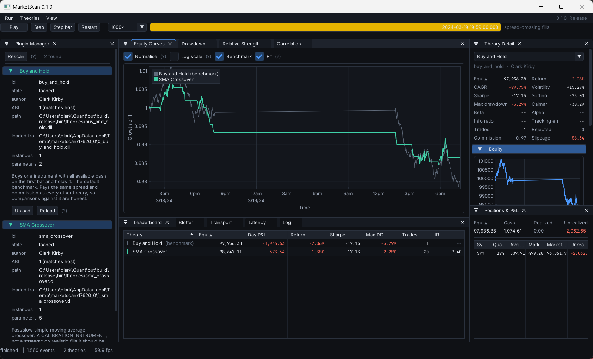

# MarketScan

A quantitative trading research platform in C++20, built around one idea:

> **A strategy cannot tell whether it is being backtested, paper traded, or trading live.**

Same strategy binary, same engine, same ledger, same fill simulator. Only the *clock* and the
*transport* swap out. There is no "backtest mode" code path to diverge from production.

The second idea is the `theories/` folder as a **USB port**: a compiled strategy plugin dropped
into it is discovered at runtime, loaded, given its own virtual account, and shown in the GUI —
with no recompile of the host and no changes to host code.



> This repository deliberately contains **no real trading strategies**, no data scrapers, no API
> clients and no network code. It ships two reference plugins — a buy-and-hold benchmark and a
> moving-average crossover whose job is to be *calibrated against*, not traded.

---

## Quickstart

```powershell
git clone https://github.com/ckirby04/MarketScan.git
cd MarketScan

./scripts/dev-env.ps1 cmake --preset release
./scripts/dev-env.ps1 cmake --build --preset release
./scripts/dev-env.ps1 ctest --preset release          # 214 tests

./out/build/release/bin/marketscan.exe --data data/samples/synthetic_spy_1min.csv
```

That opens the dashboard above: it discovers both theories in `bin/theories/`, gives each its own
virtual account, replays the committed sample day through them, and shows the result. Press
<kbd>Space</kbd> to play or pause, <kbd>→</kbd> to step one event, <kbd>Shift</kbd>+<kbd>→</kbd> to
step one bar, <kbd>Ctrl</kbd>+<kbd>R</kbd> to restart.

Add `--headless` for the same run as a table, and `--compare-fills` to see what a naive fill model
would have awarded itself:

```
Results (spread-crossing fills)
  theory                     equity   return   sharpe  sortino   max dd      IR  trades   slippage
  Buy and Hold             97936.38   -2.06%   -17.15   -23.00     3.29      --       1      56.34
  SMA Crossover            98647.11   -1.35%   -17.13   -22.25     2.25    7.40      20    1084.26

Results (OPTIMISTIC fills -- not realistic)
  Buy and Hold             97992.72   -2.01%   -16.68   -22.38     3.29      --       1       0.00
  SMA Crossover            99729.37   -0.27%    -3.51    -4.75     1.38   18.75      20       0.00

Cost of assuming optimistic fills
  Buy and Hold                   56.34  of imaginary profit
  SMA Crossover                1082.26  of imaginary profit
```

Twenty round trips, and assuming every one of them filled at the mid price manufactures **$1,082**
out of nothing — enough to turn a losing strategy into one that looks almost flat. That number is
the whole argument for the default fill model, and it is why the optimistic one is available only
as a labelled comparison.

---

## Why the design looks like this

| Decision | Reason |
|---|---|
| Pure **C** plugin ABI | MSVC debug and release CRTs have incompatible STL layouts. Passing `std::string` across a DLL boundary corrupts memory in ways that take days to find. |
| `int64` micro-dollars for cash | Binary floating point cannot represent `0.01`. Cash accounting must be exact; prices may be `double`. |
| Time only via `host->now()` | A strategy that reads the wall clock is not replayable, and a backtest you cannot reproduce is not evidence. |
| Seeded RNG from the host | Same reason. Each theory gets its own stream derived from the run seed, so adding a second theory cannot change the first one's results. |
| Fills cross the spread **by default** | An optimistic fill model turns noise into alpha — see the $1,082 above. |
| Orders can take time to arrive | Optional, off by default. A strategy that has never experienced a pending order is one trained on an assumption that breaks live — see [`docs/EXECUTION.md`](docs/EXECUTION.md). |
| A ticker is an attribute, not an identity | A ticker reused by a different company is two securities. Resolution takes a date, and the dateless overload is a compile error — see [`docs/IDENTITY.md`](docs/IDENTITY.md). |
| Survivorship is prevented structurally | A strategy is never shown a company that was not in the index that day, because the host context gives it no way to ask. Not a rule an author has to remember. |
| Benchmark is a plugin, not a special case | Buy-and-hold pays the same spread and runs through the same ledger, so the comparison is apples-to-apples by construction. |
| Metrics return **NaN**, never zero | A Sharpe ratio that is undefined and a Sharpe ratio of zero are different claims. The interface prints `--` for the first. |
| No iteration over hash containers on a decision path | Iteration order is unspecified, and an order book that depends on it is a backtest that cannot be reproduced. |

The ledger's accounting identity is asserted after every fill, in every test, and reported per
theory in the dashboard:

```
equity == starting_cash + realized − commission + unrealized
```

Exactly — not to within a rounding tolerance. That is what the micro-dollar integers buy.

---

## The data layer

```powershell
python scripts/fetch_stooq.py --symbols-file universe.txt   # free daily bars
python scripts/fetch_sp500.py                               # index membership, 1996-
marketscan.exe --headless --build-universe data/cache/universe/sp500_history.csv
marketscan.exe --headless --daily data/cache/stooq --universe data/cache/universe/sp500_history.csv
```

| | |
|---|---|
| [`docs/DATA.md`](docs/DATA.md) | Where the bars come from, the binary cache format, and a list of what this data is missing |
| [`docs/IDENTITY.md`](docs/IDENTITY.md) | Why a ticker is not an identity, and how the survivorship guard is enforced |
| [`docs/IDENTITY_DECISIONS.md`](docs/IDENTITY_DECISIONS.md) | Every identity call the engine made on the real index, including the ones that went the other way |

> **The free data stack exists to exercise machinery, not to produce
> conclusions.** No delisting returns, no point-in-time restatements, no
> corporate actions. Every number derived from it is a statement about this
> pipeline. Nothing here is committed: `data/cache/` is gitignored.

---

## Building

**Requirements**

- Windows 11, Visual Studio 2022 (MSVC v143, x64 C++ toolset)
- CMake ≥ 3.25 and Ninja — the copies bundled with Visual Studio are used automatically
- [vcpkg](https://github.com/microsoft/vcpkg) — a **full** clone (not `--depth 1`; vcpkg needs
  history to resolve versions)

```powershell
git clone https://github.com/microsoft/vcpkg.git $env:USERPROFILE\vcpkg
& $env:USERPROFILE\vcpkg\bootstrap-vcpkg.bat
```

The build finds vcpkg via `VCPKG_ROOT`, then `%USERPROFILE%\vcpkg`, then a few other conventional
locations, so no environment setup is normally required. The first configure builds the dependency
tree from source and takes a while; later ones are cached.

`scripts/dev-env.ps1` enters an MSVC developer environment before running the command it is given.
Run it once per command, as in the quickstart above.

**Presets**

| Preset | Contents |
|---|---|
| `debug` | Full desktop build, assertions on |
| `release` | Full desktop build, optimised |
| `full` | `release` plus the Python bindings |
| `ci` | Headless engine, theories and tests — no GUI dependency stack |
| `ci-debug` | `ci` with assertions on |

The two `ci` presets compile with warnings as errors (`/W4 /WX`). The desktop presets do not, so a
warning you introduce while working does not stop you building — it stops you merging.

> ⚠️ A theory plugin **must** be built with the same preset as the host that loads it. Mixing
> Debug and Release binaries across the plugin boundary is undefined behaviour on MSVC. The loader
> checks the ABI version and refuses a mismatch, but it cannot detect a CRT mismatch — so the
> presets keep their plugins in separate output trees.

---

## Writing a theory

A theory is a DLL exporting a handful of `extern "C"` functions. The SDK gives you a C++ base class
that hides the boundary:

```cpp
#include "marketscan/strategy/istrategy.hpp"

class MyTheory final : public marketscan::IStrategy {
public:
    void on_bar(const MS_Bar& bar) override {
        if (position(bar.symbol) == 0.0 && bar.close > threshold_) {
            submit_market(bar.symbol, MS_SIDE_BUY, 100.0);
        }
    }

private:
    double threshold_ = 500.0;
};

MARKETSCAN_EXPORT_STRATEGY(MyTheory, "my_theory", "My Theory", "Your Name")
```

Copy `theories/_template/`, build it, and it appears in the dashboard's Plugin Manager the next
time you press **Rescan** — no host rebuild, and no host code that knows it exists. The host
shadow-copies each DLL out of the way before loading it, so you can rebuild a theory while the
application is running and hot-reload it.

Full walkthrough, including the rules a theory has to follow (no wall clock, no `rand()`, no file
or network I/O, no allocation on the event path) and why each exists:
**[`theories/README.md`](theories/README.md)**.

---

## Python

```powershell
./scripts/dev-env.ps1 cmake --preset full
./scripts/dev-env.ps1 cmake --build --preset full
```

```python
import sys; sys.path.insert(0, "out/build/full/bin")
import marketscan as ms

result = ms.run(theories=["out/build/full/bin/theories"],
                data="data/samples/synthetic_spy_1min.csv")

for theory in result.theories:
    print(theory.display_name, theory.final_equity, theory.summary.sharpe)
```

The bindings call the same `run_backtest` the command line does, so a notebook and the desktop
application cannot disagree about what happened.

See [`bindings/python/examples/quickstart.ipynb`](bindings/python/examples/quickstart.ipynb), which
is committed with its output.

**Strategies are not written in Python.** The engine's contract is that a strategy is a pure
function of the events it was shown; a Python callback on the per-event path would make replay
speed depend on the interpreter and let a strategy close over state the engine cannot see.
Strategies are DLLs — see [`theories/README.md`](theories/README.md).

The module targets whichever Python minor version vcpkg's `python3` port provides (currently 3.12).
Override with `-DMARKETSCAN_PYTHON_EXECUTABLE=<path>` to build against a specific interpreter of
that same version.

---

## Where this is

[**`docs/STATUS.md`**](docs/STATUS.md) — what exists, what is blocked, what is
next, and how to pick the project up on a machine that has never built it.

## Milestones

| | Milestone | State |
|---|---|---|
| M0 | Repo skeleton, CMake + vcpkg + CI | ✅ |
| M1 | Core types and engine loop | ✅ |
| M2 | Data feeds | ✅ |
| M3 | Ledger and fill models | ✅ |
| M4 | Plugin ABI and loader | ✅ |
| M5 | Metrics | ✅ |
| M6 | GUI shell | ✅ |
| M7 | Full GUI | ✅ |
| M8 | Python bindings | ✅ |
| M9 | Hardening and polish | ✅ |

The ABI in `include/marketscan/abi/plugin_abi.h` was frozen at M4 and is at version 1. Every struct
in it is `static_assert`ed to its exact size, so a change that would break an already-compiled
theory cannot compile.

---

## Repository layout

```
include/marketscan/   public headers
  abi/                the frozen pure-C plugin boundary
  core/               types, money, clock, events, ring buffer, engine
  data/               market data feeds
  book/               order book
  exec/               orders, fill models, ledger
  strategy/           strategy base class, registry, plugin loader
  metrics/            performance statistics
  run/                the one run_backtest the CLI and Python both call
  util/               logging, latency histogram
src/                  implementation, mirroring include/
apps/marketscan/      the desktop application
theories/             the USB port: strategy plugins, discovered at runtime
bindings/python/      pybind11 module
tests/                Catch2 suite
data/samples/         small committed datasets for tests and first run
scripts/              developer environment, sample data, screenshots
```

---

## License

MIT — see [LICENSE](LICENSE).
